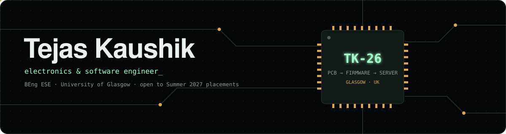

<div align="center">



<a href="https://github.com/Tejas-kaushik">
  
</a>

<p>
  <a href="https://www.linkedin.com/in/tejas-kaushik-62435b405"></a>
  <a href="mailto:tejaskaushik04@gmail.com"></a>
  
  
</p>

</div>

---

## 👋 About me

Third-year **BEng Electronics & Software Engineering** student at the **University of Glasgow**. I build things end to end, from the analogue front end and the PCB, through the firmware, up to the servers and tools that talk to them, and I measure them rather than assume they work.

```yaml
tejas:
  studying:   BEng (Hons) Electronics & Software Engineering, University of Glasgow (2024 to 2028)
  right_now:  Systems Programming (C/C++ on Linux), Communication Systems, Real-Time Computer Systems
  software:   C, C++, Python, JavaScript · Linux syscalls, epoll, TCP/IP · Django, Node.js, React
  hardware:   FreeRTOS on ESP32 · ARM Cortex-M · OrCAD schematic + PCB · scope and logic-analyser debug
  habits:     tests first, CI on every push, profile before optimising
  looking_for: Summer 2027 software / embedded / electronics engineering placement
```

## 🏆 Highlights

<table>
<tr>
<td align="center" width="25%"><h3>🥈 2nd</h3><sub><b>StrathHack26</b><br/>ScottishPower cyber security challenge</sub></td>
<td align="center" width="25%"><h3>−40%</h3><sub><b>instructions per request</b><br/>in my Redis-compatible C server, found with <code>perf</code></sub></td>
<td align="center" width="25%"><h3>200 Hz</h3><sub><b>hard-real-time PID loop</b><br/>held steady under live Wi-Fi load</sub></td>
<td align="center" width="25%"><h3>360+</h3><sub><b>automated tests</b><br/>behind the award-winning Zero Hour game</sub></td>
</tr>
</table>

## 🚀 Featured projects

### 🥈 [Zero Hour](https://github.com/Tejas-kaushik/zero-hour) · Node.js · Server-Sent Events · zero dependencies
**2nd place at StrathHack26.** A multiplayer cyber-awareness game for workplace training: teams defend a fictional energy company through an overnight cyber attack, answering timed security questions on their phones. **[▶ Live demo](https://team-20-1.onrender.com/)**

- Every game rule lives in one pure reducer, so two phones buying at the same moment can never overspend a team's budget
- Real-time sync over Server-Sent Events with server-clock countdowns and seamless reconnects
- 360+ `node --test` tests, including the shared-budget race and path-traversal hardening; a hand-written PDF writer generates each player's debrief

### ⚡ mini-redis · C17 · Linux · epoll
A Redis-compatible key-value server built from scratch on Linux system calls, no third-party libraries. The stock `redis-cli` and `redis-benchmark` work against it unmodified.

- Single-threaded `epoll` event loop, zero-copy RESP2 parser, incrementally rehashed hash table, key expiry, append-only-file persistence that survives `kill -9`
- **Matches Redis 8 throughput** on GET/SET/INCR (persistence off) with 10,000 concurrent clients
- Profiled with `perf` and callgrind: **2,788 → 1,668 instructions per request** over seven measured changes
- 39 unit + 72 integration tests, parser fuzzing, a 3M-operation stress test; CI under ASan, UBSan and valgrind

### 🤖 [esp32-line-follower](https://github.com/Tejas-kaushik/esp32-line-follower) · C++ · FreeRTOS · ESP32
An autonomous robot built from discrete components, not a kit, with dual-core real-time firmware and a live Wi-Fi tuning dashboard.

- 200 Hz PID loop pinned to its own core, isolated from the Wi-Fi stack by guarded shared state, verified flat under network load
- Async WebSocket dashboard on the ESP32: tune gains while it drives, turning a rebuild-and-reflash cycle into an instant update
- Measured and linearised motor dead-band, adaptive corner slowdown, self-calibrating sensors persisted to flash

### 🎙️ [F.R.I.D.A.Y.](https://github.com/Tejas-kaushik/Friday-AI-Assistant-) · Python · MCP · local speech
A voice assistant engineered around one latency budget: the first sound back within a second of you finishing your sentence.

- Fully local voice loop: WebRTC VAD → faster-whisper STT → LLM → Piper TTS, with every stage measured
- Tools served over the Model Context Protocol (weather, news, web search, system state) plus an async "deep analysis" job so it keeps talking while it thinks
- 17/17 on its own evaluation harness

<details>
<summary><b>More projects</b></summary>
<br/>

| Project | Stack | What it is |
|---|---|---|
| [**transient-trace-analyzer**](https://github.com/Tejas-kaushik/transient-trace-analyzer) | Python · pytest · GitHub Actions | CLI that turns oscilloscope CSV traces into RC/RLC parameters; installable package, CI on every push |
| **PPG heart-rate monitor** | Embedded C · OrCAD · custom PCB | Analogue acquisition → filtering → beat detection → live BPM; board brought up and validated on a scope |
| [**find_my_recipe_team_3A**](https://github.com/HibaBaig/find_my_recipe_team_3A) | Django · Bootstrap · AJAX | Team of four; I wrote the test suite and the "Surprise Me" ingredient matcher |
| **The Stramont** | HTML · CSS · JS · React | Website for a Glasgow café, commissioned by the owner and built to their brief |
| [**rc-rlc-transient-labs**](https://github.com/Tejas-kaushik/rc-rlc-transient-labs) | OrCAD · PSpice | RC and RLC characterisation validated against simulation |
| [**reverse-counter-display**](https://github.com/Tejas-kaushik/reverse-counter-display) | Digital logic | Breadboard countdown counter on a 7-segment display |

</details>

## 💼 Experience

**Summer Engineering Intern**, Technology Business Incubator, Graphic Era Hill University · *Jun to Jul 2026*
Built a networked air-quality monitor with a live web dashboard, from breadboard to working demonstrator, and prototyped a 3D-printed 4-DOF robotic arm with its control firmware.

## 🛠️ Tech stack

**Languages**<br/>


**Systems, tooling and web**<br/>


**Embedded and hardware**<br/>


**Testing and quality**<br/>


-555555?style=flat-square)


## 📊 GitHub activity

<div align="center">
  
  
  <br/>
  
</div>

## 🌱 Beyond code

- 🥇 Gold medallist, National Volleyball Championship (2022)
- 🎨 Creative Director, GU Indian Society · 🤝 Events Coordinator, INSA Society
- 📣 Ran a campus campaign for Domino's that drove 5,000+ student sign-ups in a single day

<div align="center">


**Let's build something.** <a href="mailto:tejaskaushik04@gmail.com">tejaskaushik04@gmail.com</a> · <a href="https://www.linkedin.com/in/tejas-kaushik-62435b405">LinkedIn</a>

</div>
