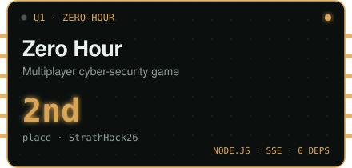
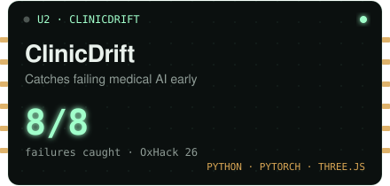
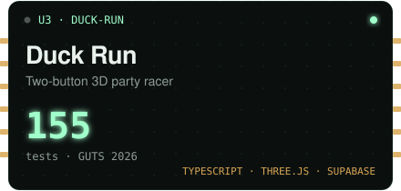
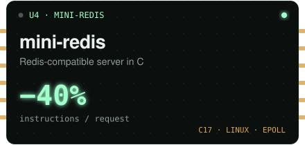
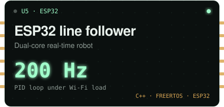
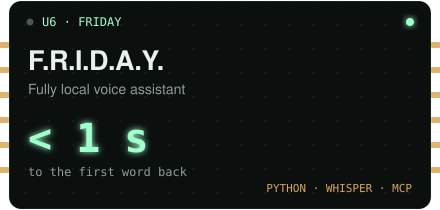
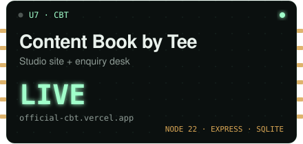
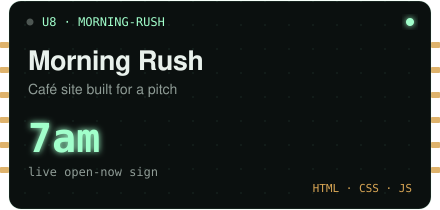
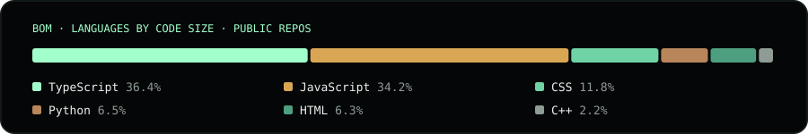

<div align="center">


<p>
  <a href="https://tejas-kaushik.github.io/"></a>
  <a href="https://www.linkedin.com/in/tejas-kaushik-62435b405"></a>
  <a href="mailto:tejaskaushik04@gmail.com"></a>
  
  
</p>

</div>

## ▍about

Third-year **BEng Electronics & Software Engineering** at the **University of Glasgow**. I build the whole path a signal takes: the analogue front end and the PCB, the firmware that samples it, the server it reaches and the tools that check every step. I measure things rather than assume they work.

```yaml
tejas:
  studying:   BEng (Hons) Electronics & Software Engineering, University of Glasgow (2024 to 2028)
  right_now:  Systems Programming (C/C++ on Linux), Communication Systems, Real-Time Computer Systems
  software:   C, C++, Python, JavaScript · Linux syscalls, epoll, TCP/IP · Django, Node.js, React
  hardware:   FreeRTOS on ESP32 · ARM Cortex-M · OrCAD schematic + PCB · scope and logic-analyser debug
  web_work:   full-stack websites for Content Book by Tee (CBT), a Glasgow content studio
  habits:     tests first, CI on every push, profile before optimising
  looking_for: Summer 2027 software / embedded / electronics engineering placement
```

## ▍featured builds

<table>
<tr>
<td width="50%"><a href="https://github.com/Tejas-kaushik/zero-hour"></a></td>
<td width="50%"><a href="https://github.com/ox-hack-26/oxhack26-surely-we-win-"></a></td>
</tr>
<tr>
<td width="50%"><a href="https://github.com/Tejas-kaushik/duck-run"></a></td>
<td width="50%"><a href="https://tejas-kaushik.github.io/"></a></td>
</tr>
<tr>
<td width="50%"><a href="https://github.com/Tejas-kaushik/esp32-line-follower"></a></td>
<td width="50%"><a href="https://github.com/Tejas-kaushik/Friday-AI-Assistant-"></a></td>
</tr>
<tr>
<td width="50%"><a href="https://official-cbt.vercel.app"></a></td>
<td width="50%"><a href="https://tejas-kaushik.github.io/mrngrush/"></a></td>
</tr>
</table>

<details>
<summary><b>Engineering notes for each build</b></summary>
<br/>

### 🥈 [Zero Hour](https://github.com/Tejas-kaushik/zero-hour) · Node.js · Server-Sent Events · zero dependencies
**2nd place at StrathHack26.** A multiplayer cyber-awareness game for workplace training: teams defend a fictional energy company through an overnight cyber attack, answering timed security questions on their phones. **[▶ Live demo](https://team-20-1.onrender.com/)**

- Every game rule lives in one pure reducer, so two phones buying at the same moment can never overspend a team's budget
- Real-time sync over Server-Sent Events with server-clock countdowns and seamless reconnects
- 360+ `node --test` tests, including the shared-budget race and path-traversal hardening; a hand-written PDF writer generates each player's debrief

### 🔬 [ClinicDrift](https://github.com/ox-hack-26/oxhack26-surely-we-win-) · Python · PyTorch · React · Three.js
**Team project at OxHack 26** for the HRT "Best Use of Data for Predictions and Decision Making" challenge. Eye-screening AIs can quietly get worse at one clinic (a wearing camera, a bad software update), and expert grades that would reveal it arrive weeks late. ClinicDrift spots it from the scans alone and decides when to pull the AI for review.

- **My part: the prediction and decision engine.** A label-free catch-rate estimate and a drift score per clinic-week, fed into a belief that updates as late grades arrive and a cost-based rule for when to alarm
- Replayed 20 weeks at 10 simulated clinics over 9,500 real retinal scans: **caught all 8 clinics that changed, with zero false alarms, in 100 of 100 redraws of the grades**, against a median of 0 of 8 for today's wait-for-grades practice
- Caught a faulty update that drift alone never sees (the scans look identical), and roughly **halved the modelled cost** (£210k vs £489k)
- Backtested against three simpler policies with a robustness sweep, so every quoted number is a range, not one lucky run

### 🦆 [Duck Run](https://github.com/Tejas-kaushik/duck-run) · TypeScript · Three.js · Supabase
**Team project at GUTS 2026** for the JPMorgan Chase "two buttons maximum" challenge. A 3D browser game where a whole room races on their phones while the big screen shows every duck on one track, with live commentary and a podium. **[▶ Play it](https://duck-run-lac.vercel.app)**

- My part: integrating the team's work into one game, the 3D rendering, the pond lobby, the multiplayer races, the big-screen spectator mode and the phone controls
- Every phone builds the identical course from the room's seed and starts on the same server clock; Supabase Realtime streams everyone's progress, with row-level security so players can only write their own results
- 155 unit tests and 60 database security checks, with CI on every push; designed on paper by the team and built with AI-assisted development

### 📖 [Content Book by Tee](https://github.com/Tejas-kaushik/Official---CBT-) · Node.js 22 · Express · SQLite · Vercel
The official website for **Content Book by Tee (CBT)**, a content studio in Glasgow and India, with the backend the team runs enquiries from. **[▶ Live site](https://official-cbt.vercel.app)**

- Public site, enquiry API and a password-protected studio desk at `/admin`, where the team moves each enquiry from new → replied → call booked → won and keeps notes
- One storage interface with two backends: Node's built-in `node:sqlite` on a disk, Upstash Redis on Vercel's serverless platform
- Signed-cookie sign-in with rate limiting, a spam trap, validation and HTML escaping, and an optional email alert per enquiry
- The logo traced into SVG so it stays sharp at any size; no build step, and `node --test` covers the form, the desk and the security checks

### ⚡ mini-redis · C17 · Linux · epoll
A Redis-compatible key-value server built from scratch on Linux system calls, no third-party libraries. The stock `redis-cli` and `redis-benchmark` work against it unmodified.

- Single-threaded `epoll` event loop, zero-copy RESP2 parser, incrementally rehashed hash table, key expiry, append-only-file persistence that survives `kill -9`
- **Matches Redis 8 throughput** on GET/SET/INCR (persistence off) with 10,000 concurrent clients
- Profiled with `perf` and callgrind: **2,788 → 1,668 instructions per request** over seven measured changes
- 39 unit + 72 integration tests, parser fuzzing, a 3M-operation stress test; CI under ASan, UBSan and valgrind

### 🤖 [esp32-line-follower](https://github.com/Tejas-kaushik/esp32-line-follower) · C++ · FreeRTOS · ESP32
An autonomous robot built from discrete components, not a kit, with dual-core real-time firmware and a live Wi-Fi tuning dashboard.

- 200 Hz PID loop pinned to its own core, isolated from the Wi-Fi stack by guarded shared state, verified flat under network load
- Async WebSocket dashboard on the ESP32: tune gains while it drives, turning a rebuild-and-reflash cycle into an instant update
- Measured and linearised motor dead-band, adaptive corner slowdown, self-calibrating sensors persisted to flash

### 🎙️ [F.R.I.D.A.Y.](https://github.com/Tejas-kaushik/Friday-AI-Assistant-) · Python · MCP · local speech
A voice assistant engineered around one latency budget: the first sound back within a second of you finishing your sentence.

- Fully local voice loop: WebRTC VAD → faster-whisper STT → LLM → Piper TTS, with every stage measured
- Tools served over the Model Context Protocol (weather, news, web search, system state) plus an async "deep analysis" job so it keeps talking while it thinks
- 17/17 on its own evaluation harness

</details>

<details>
<summary><b>More projects</b></summary>
<br/>

| Project | Stack | What it is |
|---|---|---|
| [**transient-trace-analyzer**](https://github.com/Tejas-kaushik/transient-trace-analyzer) | Python · pytest · GitHub Actions | CLI that turns oscilloscope CSV traces into RC/RLC parameters; installable package, CI on every push |
| **PPG heart-rate monitor** | Embedded C · OrCAD · custom PCB | Analogue acquisition → filtering → beat detection → live BPM; board brought up and validated on a scope |
| [**find_my_recipe_team_3A**](https://github.com/HibaBaig/find_my_recipe_team_3A) | Django · Bootstrap · AJAX | Team of four; I wrote the test suite and the "Surprise Me" ingredient matcher |
| [**Morning Rush**](https://tejas-kaushik.github.io/mrngrush/) | HTML · CSS · JS · GitHub Pages | Website preview for a Glasgow café, built for CBT from the café's own lettering and photos, with a live "open now" sign in Glasgow time |
| **The Stramont** | HTML · CSS · JS · React | Website for a Glasgow café, commissioned by the owner and built to their brief |
| [**rc-rlc-transient-labs**](https://github.com/Tejas-kaushik/rc-rlc-transient-labs) | OrCAD · PSpice | RC and RLC characterisation validated against simulation |
| [**reverse-counter-display**](https://github.com/Tejas-kaushik/reverse-counter-display) | Digital logic | Breadboard countdown counter on a 7-segment display |

</details>

## ▍hackathons

| | Event | Project | What we built |
|:-:|---|---|---|
| 🥈 | **StrathHack26** · ScottishPower challenge | [Zero Hour](https://github.com/Tejas-kaushik/zero-hour) | **2nd place.** Multiplayer cyber-awareness game played on phones |
| 🔬 | **OxHack 26** · HRT data challenge | [ClinicDrift](https://github.com/ox-hack-26/oxhack26-surely-we-win-) | Early warning when an eye-screening AI degrades at a clinic |
| 🦆 | **GUTS 2026** · JPMorgan Chase challenge | [Duck Run](https://github.com/Tejas-kaushik/duck-run) | 3D two-button party racer for a whole room |

## ▍signal




<sub>Drawn by my own script and redrawn every day by a GitHub Action, so nothing here depends on someone else's server.</sub>

## ▍experience

**Web Developer**, Content Book by Tee (CBT), Glasgow · *Oct 2026 to present*
Build the studio's own full-stack website and enquiry desk, and website previews for the cafés CBT pitches to.

**Summer Engineering Intern**, Technology Business Incubator, Graphic Era Hill University · *Jun to Jul 2026*
Built a networked air-quality monitor with a live web dashboard, from breadboard to working demonstrator, and prototyped a 3D-printed 4-DOF robotic arm with its control firmware.

## ▍stack

**Languages**<br/>


**Systems, tooling and web**<br/>


**Embedded and hardware**<br/>


**Testing and quality**<br/>


-555555?style=flat-square)


## ▍beyond code

- 🥇 Gold medallist, National Volleyball Championship (2022)
- 🎨 Creative Director, GU Indian Society · 🤝 Events Coordinator, INSA Society
- 📣 Ran a campus campaign for Domino's that drove 5,000+ student sign-ups in a single day

<div align="center">


**Let's build something.** <a href="mailto:tejaskaushik04@gmail.com">tejaskaushik04@gmail.com</a> · <a href="https://tejas-kaushik.github.io/">tejas-kaushik.github.io</a> · <a href="https://www.linkedin.com/in/tejas-kaushik-62435b405">LinkedIn</a>

</div>
